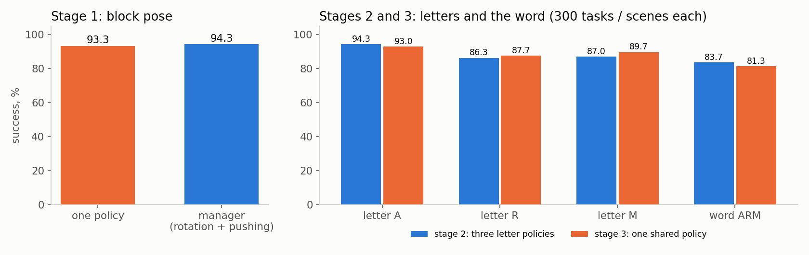
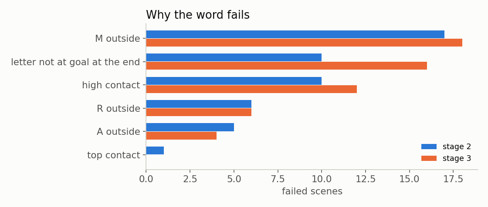
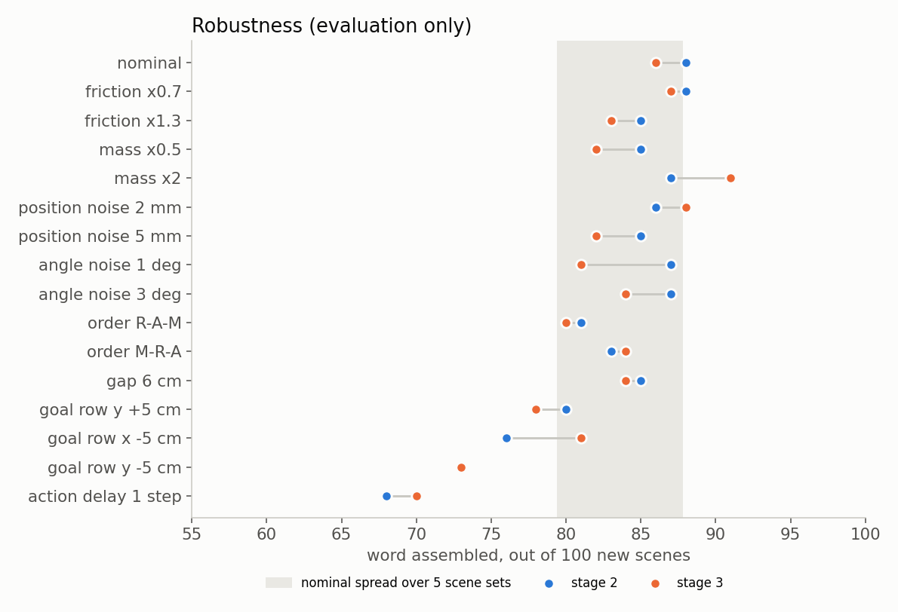
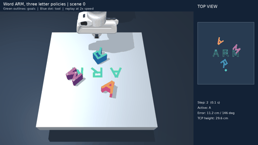

# Phase 5 — Pose pushing and assembling the word ARM

In this phase the Franka FR3 pushes objects on a table in MuJoCo, now to a full planar pose: position **and** orientation. It first pushes a rectangular block, then the letters A, R and M, and finally places all three letters in a row so that they read ARM. The hand has closed fingers, so every object is pushed, never picked up.

The phase follows three stages:

| Stage | Objects | Policies | Goal |
|---|---|---|---|
| 1 | block | 1 | position + orientation |
| 2 | A, R, M | 3, one per letter | each letter to its pose, then the word ARM |
| 3 | A, R, M | 1 shared policy with a one-hot letter ID | the same tasks with one network |

This folder contains the final configuration and every model needed to run it. Intermediate experiments and checkpoints are omitted.

## How it works

**Control.** All policies use the same controller as Phase 4: the action moves the tool target by up to 5 mm in X/Y and 4 mm in Z per control step (20 Hz), a local inverse-kinematics controller turns the target into seven joint positions, and MuJoCo simulates the contacts. The hand orientation is fixed. The tool may move inside X = 0.32–0.72 m, Y = ±0.32 m; this box was checked on a 2 cm grid (joint margin ≥ 5°, no robot–table contact).

**Observation.** The pushing policies receive 30 numbers: tool and object positions, the object position in the goal frame and the tool position in the object frame, object and goal orientation as cos/sin of the yaw, the required turn, velocities, controller lag and the filtered command. Orientation is never encoded with a symmetry trick, because the letters are not symmetric.

**Reward.** Progress towards the goal position (100 per metre) and towards the goal yaw (10 per radian), +50 when the pose is reached and held, −20 on a physical failure (object off the table, tilted or lifted, contact from above or too high, joint limit).

**Success.** Position error below **2 cm** and yaw error below **10°**, held for **0.3 s**. For the word, all three letters must be in their slots at the end of the episode.

### Stage 1 — block

Two variants are included.

- **One policy** (the required variant). It was obtained in two steps. First, a task manager (below) was used as a teacher, and one network learned to imitate it with DAgger: the student drives, the teacher labels every visited state, five iterations. Then the student was fine-tuned with PPO on the task reward, with a behaviour-cloning term that decays to zero.
- **Task manager.** If the yaw error is larger than 40°, a scripted move brings the tool next to the block and a rotation policy turns the block in place until the error is below 30°. The rotation policy uses discrete pusher velocities (11 per axis), following Del Aguila Ferrandis et al. (2023, arXiv:2308.02459). Then a pushing model moves the block to the final pose. If the error grows again, rotation and pushing are repeated (at most twice).

### Stage 2 — three letter policies and the word

Each letter (6 × 6 cm, 5 cm tall, built from boxes) has its own policy, initialised from the one-policy block model. Training had two steps: PPO on single-letter tasks, then PPO on states that the word manager really visits (75 %, recorded from manager runs) mixed with single-letter tasks (25 %). In the word states, the displacement of letters that are already in place is penalised, and moving one by more than 1 cm or 5° ends the episode.

The word manager handles A → R → M. For each letter it lifts the tool, moves to the start point, descends next to the letter at a free spot, cuts the straight path to the slot into pieces of at most 12 cm, and lets the letter's policy push along these pieces. After the first pass, letters that are not in their slot (or were pushed away) are corrected in up to four repair passes; the whole episode is limited to 9000 steps (450 s).

### Stage 3 — one shared policy

One network handles all three letters. Its input is the same 30 numbers plus a one-hot ID: A = [1, 0, 0], R = [0, 1, 0], M = [0, 0, 1]. It was trained with DAgger from the three stage-2 policies as teachers. A further PPO fine-tuning did not improve it, so the submitted model is the DAgger student. The word is assembled with the same manager.

## Results

All final tests use task sets that were generated after the models had been selected on separate development sets (seeds below), 300 tasks or scenes each.

| Stage | Task | Model | Success |
|---|---|---|---:|
| 1 | block pose | one policy | **280/300 — 93.3 %** |
| 1 | block pose | task manager | 283/300 — 94.3 % |
| 2 | letter A / R / M | 3 letter policies | 283 / 259 / 261 of 300 |
| 2 | **word ARM** | 3 letter policies + manager | **251/300 — 83.7 %** |
| 3 | letter A / R / M | 1 shared policy | 279 / 263 / 269 of 300 |
| 3 | **word ARM** | 1 shared policy + manager | **244/300 — 81.3 %** |



The shared policy is as good as the three separate ones: the word was assembled in 222 scenes by both, in 29 only by stage 2 and in 22 only by stage 3 (sign test p ≈ 0.40). A word succeeds more often than the product of the three single-letter rates would suggest (0.94 × 0.86 × 0.87 ≈ 71 %), because the repair passes correct letters that were not placed at the first attempt.

Most failed words are a letter that leaves the table area while it is being turned by about 180°:



[Summary](results/summary.json) · [Table](results/SUMMARY.md) · [Word episodes, stage 2](results/stage2_word_episodes.json) · [Word episodes, stage 3](results/stage3_word_episodes.json)

Seeds — development: block 500000, letters 512000 / 522000 / 532000, word 542000 and 543000. Final tests: block 950000, letters 961000 / 971000 / 981000, word 992000.

### Robustness

Evaluation only (no training), 100 new scenes per condition (seed 994000), and the nominal configuration on five further scene sets (995000–999000).



- Friction ×0.7 / ×1.3, letter mass ×0.5 / ×2 and observation noise up to 5 mm / 3° stay within the normal scene-to-scene spread.
- A different letter order (R→A→M, M→R→A) costs a few scenes; the training states came from the order A→R→M.
- Moving the goal row by 5 cm costs more, because the goals were always at the same place during training.
- A one-step action delay is the largest weakness. A real robot would need a low-latency loop or training with the delay.

[Robustness data](results/robustness.json)

## Movement examples



Left: the scene. Right: a top view with the letters, their goal outlines (green), the path of the active letter and the tool (blue), plus the step, the active letter and its error. The replay runs at about twice simulation speed.

[Word, shared policy](results/word_stage3.gif) · [Block, one policy](results/block_one_policy.gif) · [Block, manager](results/block_manager.gif) · [Failed word](results/word_failure.gif) · MP4 versions are next to the GIFs.

These are single examples; the percentages come from all 300 scenes.

## Running

Tested on Linux with Python 3.12 and CPU PyTorch. From the repository root:

```bash
bash Faza5/setup.sh
bash Faza5/run_demo.sh word
```

The demo opens the MuJoCo viewer and plays test scenes one after another. Close the window to stop. Other modes: `cube`, `cube-manager`, `word-shared`; `--index N` selects the scene, `--gif file.gif` records a replay instead of opening the viewer.

To repeat all final tests or the robustness tests without a window:

```bash
bash Faza5/run_test.sh
bash Faza5/run_robustness.sh
```

Results go to a new folder under `Faza5/runs/`. Both repeat the saved test sets; they are not new independent tests.

## Training

Each step reads the previous step's result from `runs/`. Run the commands from `Faza5/code` with `../.venv/bin/python`.

| Step | Command |
|---|---|
| rotation policy | `-m stage1_cube.train_rotate` |
| one block policy, DAgger | `-m stage1_cube.dagger` |
| one block policy, PPO | `-m stage1_cube.finetune --init ../runs/stage1_dagger/student_iter4.zip` |
| letter policy, single letters | `-m stage2_letters.train_letter --letter A` |
| record word states | `-m stage2_letters.word_manager --scenes 600 --seed 645000 --record --out ../runs/word_states` |
| letter policy, word states | `-m stage2_letters.train_word_states --letter A --init ../runs/stage2_letter_A/best.zip` |
| shared policy, DAgger | `-m stage3_shared.dagger` |
| shared policy, PPO (optional) | `-m stage3_shared.finetune --init ../runs/stage3_dagger/student_iter3.zip` |

PPO fine-tuning uses learning rate 3·10⁻⁵, clip range 0.1, rollouts of 1024 steps per environment, batch 2048 and 10 epochs; the value network is first trained alone for 100k–300k steps with the actor frozen. The pushing model of the task manager is the result of a chain of earlier fine-tuning runs from the Phase 4 model and is included only as a trained file. The rotation policy, the one block policy and the first letter step were trained with a smaller tool box (X 0.30–0.65 m, Y ±0.21 m); the word-state step and all tests use the box above. A new run uses the larger box everywhere, so it is not guaranteed to reproduce the exact numbers.

## Code

| File | Purpose |
|---|---|
| [common/settings.py](code/common/settings.py) | Physics, tool box and success limits |
| [common/controller.py](code/common/controller.py) | Tool commands and inverse kinematics |
| [common/block_sim.py](code/common/block_sim.py) | Block scene: reset, physics step, failure rules |
| [common/rollout.py](code/common/rollout.py), [common/training.py](code/common/training.py) | Parallel episodes, DAgger fitting, PPO with a decaying BC term |
| [stage1_cube/](code/stage1_cube) | Block tasks, one-policy environment, rotation policy, task manager, DAgger teacher |
| [stage2_letters/](code/stage2_letters) | Letter shapes, letter environment, word scene, word manager, training on word states, test conditions |
| [stage3_shared/](code/stage3_shared) | Shared environment with the one-hot ID, DAgger, optional PPO |
| [evaluate_final.py](code/evaluate_final.py) | All final tests and `results/SUMMARY.md` |
| [robustness.py](code/robustness.py) | Word under changed conditions |
| [demo.py](code/demo.py) | Viewer and replay recording |
| [make_plots.py](code/make_plots.py) | Plots in `results/` |

`models/` holds the submitted models: `stage1_cube_policy.zip` (one block policy), `stage1_rotate.zip` + `stage1_rotate_vecnormalize.pkl` and `stage1_push.zip` (task manager), `stage2_letter_{A,R,M}.zip` and `stage3_shared.zip`. `mujoco/` contains the scene, the robot meshes and their source and license. The results are from simulation only; the robot has not been tested on real hardware, and no camera is used — object poses come from the simulator.
