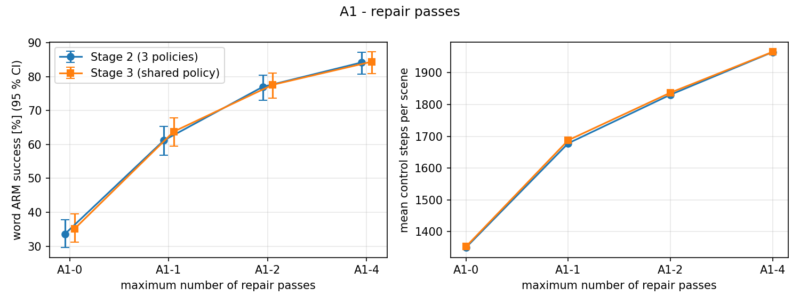
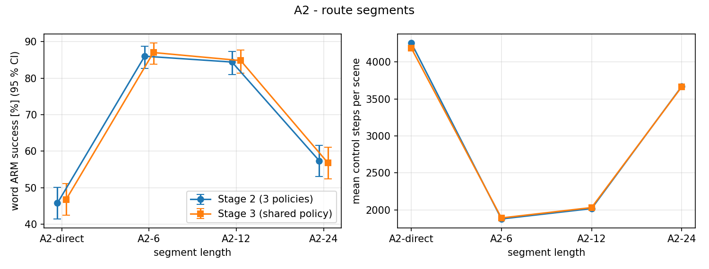
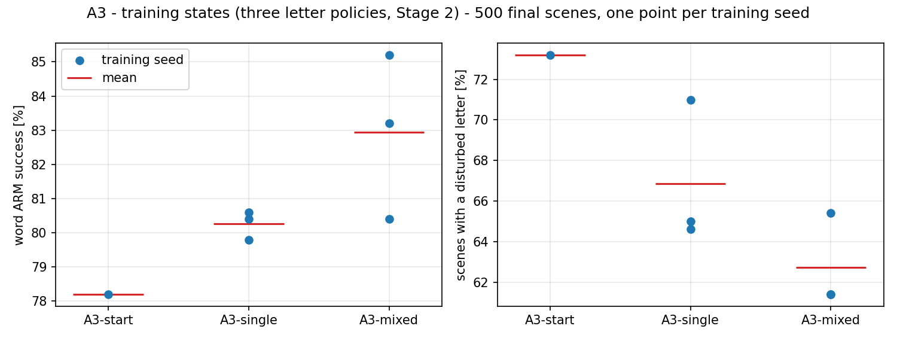
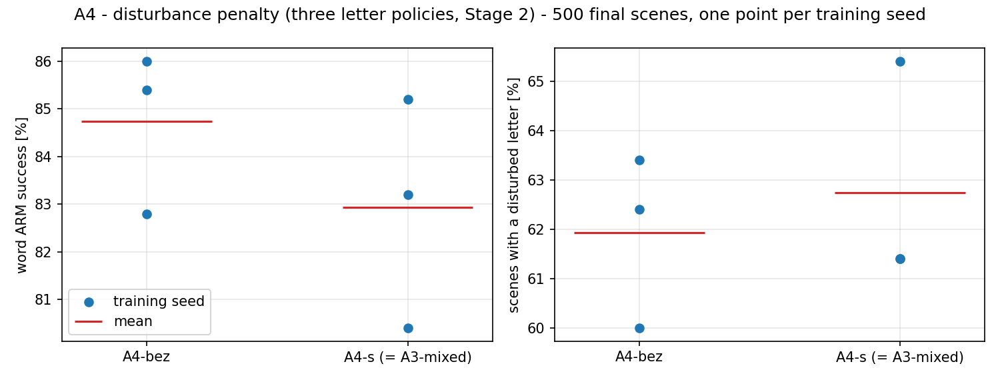
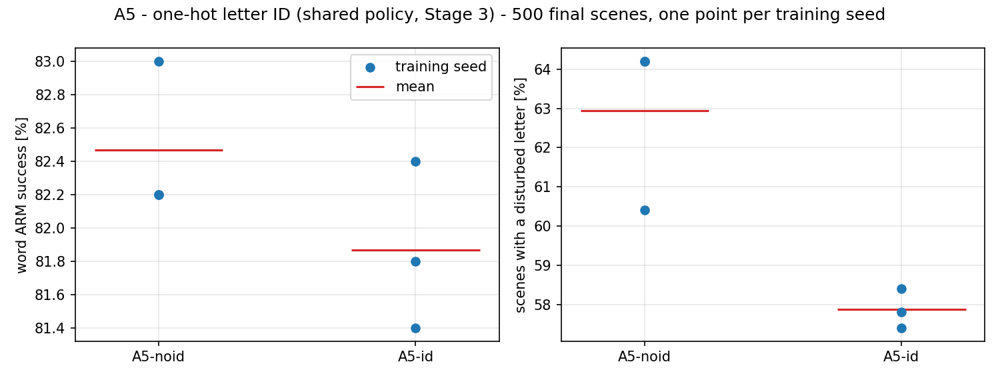

# Phase 6: Ablation study of the ARM word assembly

Phase 5 ended with a system that builds the word ARM: a Franka FR3 in MuJoCo pushes the letters A, R and M into a row. It has two kinds of parts. The letter policies are trained with PPO (three separate ones in Stage 2, one shared policy with a one-hot letter ID in Stage 3). The word manager around them is scripted: it moves the hand, lowers it next to a letter, cuts the path into short pieces and runs repair passes at the end.

The final result of Phase 5 was about 84 % of words, but that number alone does not say which of these parts matters. In this phase individual parts are switched off or changed, one at a time, and the effect is measured on the same scenes.

| | What is changed | Training | Result in one line |
|---|---|---|---|
| A1 | repair passes: 0, 1, 2, 4 | no | repairs add 51 percentage points |
| A2 | piece length: none, 6, 12, 24 cm | no | without pieces the word drops from 84 % to 46 % |
| A3 | fine-tuning data: none, single letters only, word states | yes, 3 seeds | word states help, but not clearly more than plain extra training |
| A4 | reward penalty for moving placed letters: off, on | yes, 3 seeds | no measurable effect |
| A5 | letter ID in the shared policy: without, with | yes, 3 seeds | same success, fewer disturbed letters with the ID |

## How the comparison was set up

The rules were written down before the final runs, in [PROTOCOL.md](PROTOCOL.md). In short:

- `Faza5/` stays as it is (commit `278d2cd`). Phase 6 loads the scene and the final models from there. The code in `Faza6/code` is a copy of the Phase 5 code with a few new options; with default options it behaves exactly like Phase 5.
- To check this, the Phase 5 code and the Phase 6 code were run on the same 150 scenes. All 150 scenes came out identical: success, steps, repairs, disturbed letters and final errors. This also shows that the evaluation is deterministic, so a variant without training needs only one run.
- Scenes: 150 development scenes (seed 1102000) for checks, and 500 final scenes (seed 1202000) for every number in this README. Every variant sees the same 500 start poses. The Phase 5 test set (seed 992000) is not used anywhere. Single-letter tests use 300 new tasks per letter (seeds 1301000, 1311000, 1321000).
- A word counts as built if at the end of the scene all three letters are within 2 cm and 10° of their goals.
- A scene counts as disturbed if a letter that was already in place moved by more than 1 cm or 5° from where it was placed.
- Steps are all 20 Hz control steps of the scene, including scripted moves and repairs. A scene is limited to 9000 steps (450 s).
- Every failed scene gets one reason: `letter_outside` (a letter left the table area), `high_contact` / `top_contact` (the hand touched a letter too high or from above), `total_limit` (out of steps) or `passes_exhausted` (no passes left, a letter is still not at its goal).
- Each variant is reported with its success rate and a 95 % Wilson interval. Two variants are compared scene by scene: difference in percentage points with a paired 95 % interval (Newcombe) and the exact McNemar test. Trained variants are reported per training seed, with a bootstrap interval over seeds and scenes.

Software: Python 3.12, MuJoCo 3.3.7, Stable-Baselines3 2.7.0, PyTorch 2.8.0 (CPU), full list in [results/environment.txt](results/environment.txt). Model checksums are in [results/models_sha256.txt](results/models_sha256.txt).

## Results

All rows below are separate runs on the same 500 scenes. For trained variants the value is the mean over three training seeds ± standard deviation, with the number of built words of each seed in brackets. Steps, disturbed scenes and repairs are for Stage 2 (for A5 Stage 3).

| Variant | Word, Stage 2 | Word, Stage 3 | Mean steps | Disturbed scenes | Repairs per scene |
|---|---|---|---|---|---|
| A1-0 (no repairs) | 33.6 % [29.6, 37.9] | 35.2 % [31.1, 39.5] | 1350 | 57 % | 0 |
| A1-1 | 61.2 % [56.9, 65.4] | 63.8 % [59.5, 67.9] | 1678 | 59 % | 0.77 |
| A1-2 | 77.0 % [73.1, 80.5] | 77.6 % [73.7, 81.0] | 1831 | 59 % | 1.07 |
| A1-4 (Phase 5) | 84.2 % [80.7, 87.1] | 84.4 % [81.0, 87.3] | 1965 | 59 % | 1.26 |
| A2 no pieces | 45.8 % [41.5, 50.2] | 46.8 % [42.5, 51.2] | 4259 | 44 % | 1.95 |
| A2 6 cm | 86.0 % [82.7, 88.8] | 87.0 % [83.8, 89.7] | 1876 | 56 % | 1.07 |
| A2 12 cm | 84.4 % [81.0, 87.3] | 84.8 % [81.4, 87.7] | 2016 | 60 % | 1.25 |
| A2 24 cm | 57.4 % [53.0, 61.7] | 56.8 % [52.4, 61.1] | 3671 | 50 % | 1.85 |
| A3 start model | 78.2 % [74.4, 81.6] | | 2500 | 73 % | 1.95 |
| A3 single letters | 80.3 ± 0.4 % (402, 403, 399) | | 2085 | 67 % | 1.51 |
| A3 word states (= A4 with penalty) | 82.9 ± 2.4 % (402, 426, 416) | | 1930 | 63 % | 1.33 |
| A4 without penalty | 84.7 ± 1.7 % (427, 414, 430) | | 1939 | 62 % | 1.33 |
| A5 without ID | | 82.5 ± 0.5 % (411, 411, 415) | 2019 | 63 % | 1.34 |
| A5 with ID | | 81.9 ± 0.5 % (409, 407, 412) | 1955 | 58 % | 1.22 |

The complete tables, including the final position and angle errors of each letter (median and 90th percentile) and the failure reasons of every variant, are in [results/RESULTS.md](results/RESULTS.md). They are generated from the per-scene files by `python -m faza6.report`.

### A1: Repair passes

After the first pass A → R → M, the manager goes back to every letter that is not at its goal, either because it was not placed or because a neighbour pushed it away. Here only the maximum number of these passes changes.



Without repairs only a third of the words are built. Each further pass helps less: +27.6 pp from 0 to 1 pass, +15.8 pp from 1 to 2 and +7.2 pp from 2 to 4 (Stage 2, all p < 0.001). Four passes cost 46 % more steps on average, but the median scene needs only 300 more steps, because most scenes need one repair or none. Stage 2 and Stage 3 behave the same.

Repairs do not prevent disturbances; about 58 % of the scenes have a disturbed letter in every variant. They only put the letters back. With no repairs, most failed scenes simply end with a letter off its goal (292 of 332). With four passes, mostly physical failures remain: a letter outside the area (39) or a contact that is too high (18).

One side note: the paired comparisons are one-sided, for example 138 scenes solved only with one repair and 0 only without. That follows from determinism: a run with k passes is identical to the run with 4 passes until pass k ends.

### A2: Route pieces

Instead of sending the policy straight to the final pose, the manager cuts the path into pieces of at most 12 cm. To compare piece lengths fairly, one thing had to change first. In Phase 5 the budget depended on the number of pieces: 500 steps per intermediate piece and 600 for the last one, but 1000 if there was only one piece. So a longer route simply got more time. In this experiment every placement attempt gets the same 1600 policy steps for all its pieces together. The value 1600 was fixed before the runs; it is the Phase 5 budget for three pieces, the longest route that is common. The new 12 cm run is the reference; it differs from A1-4 by one scene.



Without pieces only 45.8 % of the words are built (−38.6 pp against 12 cm, interval [−43.1, −33.9]); with 24 cm pieces 57.4 % (−27.0 pp). 6 cm is slightly better than 12 cm (+1.6 pp), but the interval [−2.1, 5.3] includes zero, so the two cannot be told apart on 500 scenes.

The reason is visible when the first attempts are split by the distance the letter has to travel:

| Distance to the goal | 0–12 cm | 12–20 cm | 20–30 cm |
|---|---|---|---|
| no pieces | 95 % | 68 % | 21 % |
| 12 cm pieces | 95 % | 95 % | 89 % |

The policies were trained on moves of 0–15 cm. A goal further away is something they have never seen, and often they just stop in front of the letter and do not move it until the budget runs out. The pieces keep every goal within the range the policies know. A limitation: the word states used for fine-tuning were recorded with 12 cm pieces, which gives 12 cm an advantage over 24 cm and no pieces.

### A3: Training on word states

In Phase 5 every letter policy was trained in two steps: first on single-letter tasks, then on a mix of 75 % word states (situations recorded from real word runs, with the other letters on the table) and 25 % single tasks. The second step improved the word, but it was also the first training in the larger tool area that Phase 5 introduced at the end. So it was not clear whether the word states helped or simply the extra training.

All variants start from the same checkpoints after the first step (`models/start/`, the ones the Phase 5 fine-tuning started from). The two continuations differ only in the share of single tasks (1.0 or 0.25). Everything else is the same: 100 000 steps of critic warm-up, 1.5 M PPO steps, 3 environments, the same hyperparameters, and the last checkpoint is used without any selection. Each continuation was trained three times with different seeds.



| | Word success | Disturbed scenes | Single letters A / R / M (of 300) |
|---|---|---|---|
| start model | 78.2 % | 73 % | 275 / 270 / 270 |
| single letters only | 80.3 ± 0.4 % | 67 % | 280 / 273 / 277 |
| word states | 82.9 ± 2.4 % | 63 % | 275 / 264 / 273 |

Word states against no fine-tuning: +4.7 pp [0.4, 9.0]. Word states against the same amount of single-letter training: +2.7 pp [−1.1, 6.6], not significant. So part of the Phase 5 gain came just from training longer in the new area. What the word states do bring clearly is a cheaper assembly: fewer steps (1930 against 2085) and fewer repairs. The number of disturbed scenes is also lower, but that difference (−4.1 pp, [−9.5, 0.9]) is not significant either. They cost a bit of single-letter skill, mostly for R.

The seed turned out to matter as much as the training data: the three word-state models build 80.4, 85.2 and 83.2 % of the words. The Phase 5 model (84.2 % on these scenes) fits into this range. With one training run, a difference of 2–3 pp cannot be trusted.

### A4: Penalty for disturbing placed letters

When a letter policy is trained on word states, its reward contains a small penalty for every movement of letters that are already placed (100 per metre, 10 per radian). An episode also ends with −20 if such a letter moves by more than 1 cm or 5°. Here the small penalty is set to zero and the termination stays. The variant with the penalty is exactly the word-state variant from A3, so its three models are reused.



| | Word success | Disturbed scenes | Disturbance events per scene |
|---|---|---|---|
| without penalty | 84.7 ± 1.7 % | 62 % | 1.31 |
| with penalty (Phase 5) | 82.9 ± 2.4 % | 63 % | 1.30 |

There is no measurable difference (disturbed scenes −0.8 pp [−5.3, 3.4], success +1.8 pp [−2.3, 5.9]). There are two likely reasons. The termination already punishes every real disturbance, and before that point the penalty adds only about −1 per centimetre. More importantly, the policies do not see the other letters at all, because their 30 inputs describe only the hand and the active letter. They cannot learn to avoid a neighbour they do not know about. About 60 % of the scenes have a disturbed letter in every Stage 2 variant, and it is the repairs that fix them.

### A5: Letter ID of the shared policy

The shared Stage 3 policy gets three extra inputs that say which letter it pushes. To test whether it needs them, two versions were trained from scratch with the same DAgger recipe: start from the Phase 5 policy of letter A, the three Phase 5 letter policies as teachers, four iterations, last iteration used, three seeds each. In one version the ID inputs are always zero. After training, their weights are set to zero too. That changes nothing in the trained network, because those inputs never had any value, but it lets the word manager use the model without any change. This recipe is not the one that produced the Phase 5 shared model, so only the two A5 versions are compared with each other.



| | Word success | Disturbed scenes | Single letters A / R / M (of 300) |
|---|---|---|---|
| without ID | 82.5 ± 0.5 % | 63 % | 272 / 271 / 261 |
| with ID | 81.9 ± 0.5 % | 58 % | 280 / 260 / 268 |

The ID does not change the success (−0.6 pp [−3.5, 2.4]). The letters are all 6 × 6 cm and pushed at the same height, so one way of pushing works for all of them. It does reduce the disturbed scenes by 5.1 pp [−8.9, −1.2]. With the ID the student copies each teacher about three times more precisely (imitation error 0.003 against 0.009). Without it, it learns an average of the three teachers, which pushes less precisely next to the other letters.

## Failures

The remaining failures were studied by replaying individual scenes with `python -m faza6.replay`. Each replay gave exactly the logged result. On the left is the scene, on the right a top view with the goals in green and the hand as a blue dot. The MP4 files next to the GIFs are easier to step through.

| | Scene | Reason | What happens | Why |
|---|---|---|---|---|
| 1 | [scene 4](plots/failures/scene4.gif), Stage 2 | letter outside | A and R are in place. M turns while it is pushed, slides away from the row and leaves the area after 109 steps, pushing A on the way. | The most common failure (M outside in 23 of 79 failed scenes). A large turn needs space, and the policy does not know where the area ends. |
| 2 | [scene 2](plots/failures/scene2.gif), Stage 2 | high contact | The first push on A stops after 10 steps because the hand touches the letter too high. | Right after the scripted descent the hand is very close to the letter, and the first moves hit it above the allowed height. |
| 3 | [scene 15](plots/failures/scene15.gif), Stage 2 | high contact | All letters are placed, but pushing M moved R by 2.2 cm, just over the 2 cm limit. The repair starts by lifting the hand, and on the way up it catches M. | Not a policy problem but the scripted lift, which goes straight up from the last contact point. 13 of the 79 failed scenes end in a scripted move like this. |
| 4 | [scene 11](plots/failures/scene11.gif), Stage 2 | no passes left | R ends up near the robot base, 21.8 cm from its goal. All four repairs finish with exactly the same error. | Probably the hand cannot get behind the letter there. Since everything is deterministic, a repair from the same state repeats the same failed attempt. |
| 5 | [scene 221](plots/failures/scene221.gif), Stage 2 | out of steps | R is 27.8 cm away and turned by 177°. The repairs use 1600, 1600, 1600 and 768 steps without moving it. | The same as 4, only each attempt uses its whole budget until the scene limit is reached. |
| 6 | [scene 10](plots/failures/scene10_direct.gif), A2 without pieces | out of steps | R has to move 18 cm. The policy stops in front of it and does not push it in any of five attempts. With 12 cm pieces this scene succeeds. | The goal is further than anything the policy was trained on (see A2). |

Two more things from the per-scene data. First, Stage 2 and Stage 3 fail in different scenes: of the failed scenes in A1-4, 36 fail with both, 43 only with Stage 2 and 42 only with Stage 3, so many failures depend on details of one scene rather than on the policy type. Second, repeating a repair from an unchanged state is wasted time (scenes 11 and 221). A manager that notices this and approaches the letter from another side, or gives up earlier, would save steps. This was not changed here, because the experiment would then measure a different system.

## Conclusions

1. The scripted manager contributes the most. Repairs add 50.6 pp and route pieces 38.6 pp. Both work around limits of the policies: pieces keep goals within the trained range, repairs put back letters that were missed or pushed away.
2. The training choices change the result by a few points. Word states help against no fine-tuning (+4.7 pp) and make the assembly cheaper, but are not clearly better than the same amount of single-letter training. The disturbance penalty has no measurable effect. The letter ID does not change the success but lowers the number of disturbed scenes by about 5 pp.
3. Training randomness is as large as these effects: three seeds of the same setup differ by up to 4.8 pp. Small differences need several training runs.
4. Stage 2 and Stage 3 give the same results in every manager variant (differences of at most 2.6 pp, all within the intervals).
5. The main remaining problems are letters that slide out of the area during large turns, the scripted lift before a repair, and repairs that repeat the same failed attempt. Natural next steps would be a repair that changes the approach point, a safer lift, and training on longer moves and larger turns.

## Running it

Everything runs from the repository root with the Phase 5 environment (`bash Faza5/setup.sh`). Finished variants are skipped, so a script can be started again after an interruption.

```bash
bash Faza6/run_ablations.sh control   # 150 development scenes, Phase 6 code with default options
bash Faza6/run_ablations.sh A1        # about 40 min on 12 CPU cores
bash Faza6/run_ablations.sh A2        # about 1 h
bash Faza6/run_ablations.sh A3        # 18 trainings + evaluation, about 3.5 h
bash Faza6/run_ablations.sh A4        # 9 trainings + evaluation, about 2 h
bash Faza6/run_ablations.sh A5        # 6 DAgger runs + evaluation, about 1.2 h
cd Faza6/code && ../../Faza5/.venv/bin/python -m faza6.report   # results/RESULTS.md and the plots
```

The options that the experiments change (run from `Faza6/code`):

| Experiment | Command |
|---|---|
| A1 | `python -m stage2_letters.word_manager --scenes 500 --seed 1202000 --repair 0 --out ../results/A1/stage2/repair0` (Stage 3: add `--shared ../../Faza5/models/stage3_shared.zip`) |
| A2 | same, with `--segment-length 0.06 --attempt-budget 1600` (`0` means no pieces) |
| A3 | `python -m stage2_letters.train_word_states --letter A --single-fraction 1.0 --seed-offset 0 --out ...` (`0.25` = word states) |
| A4 | `python -m stage2_letters.train_word_states --letter A --disturb-position 0 --disturb-angle 0 --seed-offset 0 --out ...` |
| A5 | `python -m stage3_shared.dagger --iterations 4 --seed 0 --no-id --out ...` (without `--no-id` = with the ID) |
| replay | `python -m faza6.replay --index 11 --gif ../plots/failures/scene11.gif`, plus the options of the variant |

## What is in this folder

```
Faza6/
  PROTOCOL.md          rules fixed before the final runs
  run_ablations.sh     runs control and A1-A5
  code/                Phase 5 code with the new options, and faza6/ (statistics, report, replays)
  results/             one folder per variant: summary.json, scenes.csv, episodes.json, letters.json
  plots/               plots and the failure replays
  models/start/        letter checkpoints before word-state training, and the recorded word states
  models/A3-*, A4-*, A5-*   trained models, one folder per training seed
```
